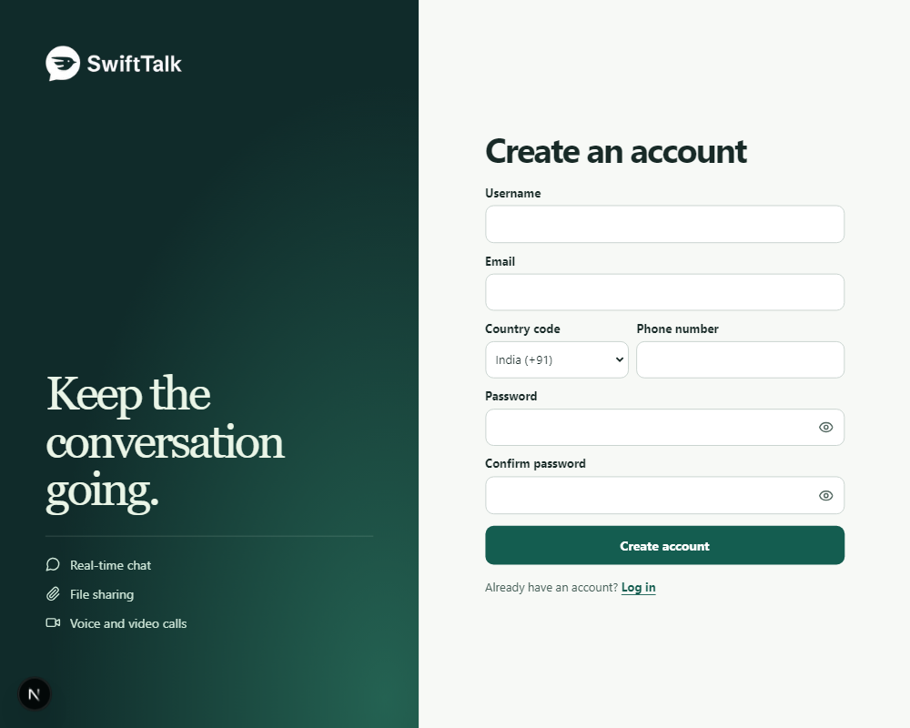
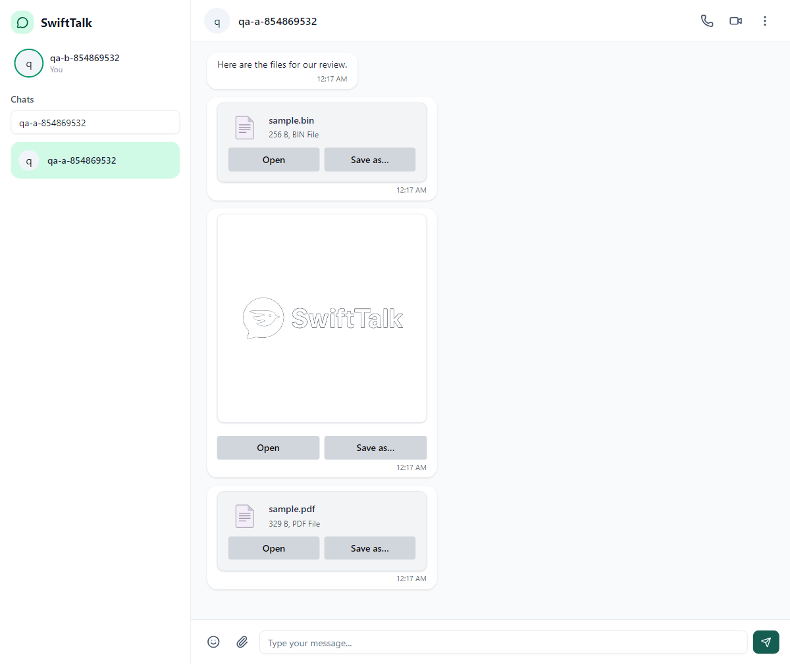
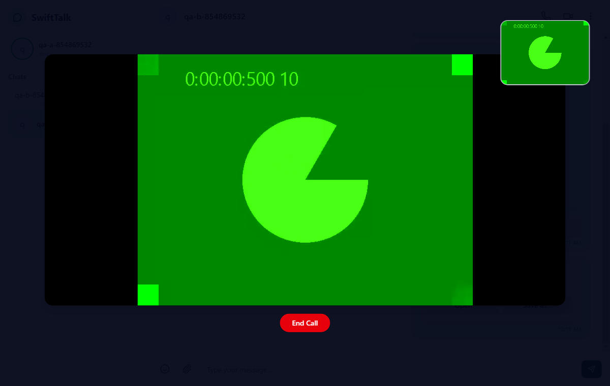
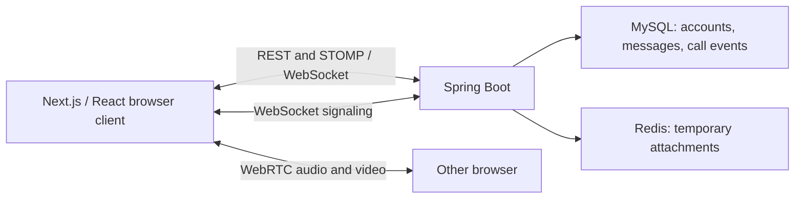

# SwiftTalk

SwiftTalk is a full-stack messaging app for direct conversations, file sharing, and browser voice and video calls. It combines a Next.js interface with a Java 21 Spring Boot backend, MySQL for persistent data, and Redis-compatible storage for temporary attachments.

## Features

| Feature | What it does |
| --- | --- |
| Accounts and profiles | Create an account, sign in with email and password, edit your username and bio, and upload a profile photo. Local signup opens chat directly. |
| Direct messaging | Send messages in real time over STOMP and WebSocket. Reopen a conversation to load its history from MySQL. |
| Attachments | Share images, PDFs, and other files. Images display inline, and recipients can open or download attachments from the conversation. |
| Voice and video calls | Start a WebRTC call from a conversation. The recipient can accept or decline, and either participant can hang up. |

## Screenshots

### Signup



### Messaging and attachments



### Video calling



The screenshots use test accounts and synthetic camera input.

## Architecture



## Run locally on Windows

You need JDK 21, Node.js 22, MySQL, and a Redis-compatible service for attachments. The Maven wrapper downloads Maven when needed.

1. Create the application database and a dedicated MySQL user. Replace the sample password and enter the same value when the backend prompts for it.

   ```sql
   CREATE DATABASE swift_db CHARACTER SET utf8mb4;
   CREATE USER 'swifttalk'@'127.0.0.1' IDENTIFIED BY 'REPLACE_WITH_YOUR_LOCAL_PASSWORD';
   GRANT ALL PRIVILEGES ON swift_db.* TO 'swifttalk'@'127.0.0.1';
   ```

2. Start the backend from the repository root. The default MySQL address is `127.0.0.1:3306`. Use `DB_URL` and `DB_USER` if your connection differs.

   ```powershell
   Set-Location .\SwiftTalk_Backend
   $env:JAVA_HOME = 'C:\Program Files\Java\jdk-21'
   $env:DB_PASSWORD = Read-Host 'SwiftTalk MySQL password'
   $env:JWT_SECRET = [Convert]::ToBase64String([Text.Encoding]::UTF8.GetBytes([guid]::NewGuid().ToString() + [guid]::NewGuid().ToString()))
   .\mvnw.cmd '-Dspring-boot.run.profiles=local' spring-boot:run
   ```

3. Start the frontend in another terminal from the repository root.

   ```powershell
   Set-Location .\swifttalk-frontend
   npm.cmd ci
   npm.cmd exec -- next dev --port 3002 --hostname 127.0.0.1
   ```

4. For attachments, start Redis at `127.0.0.1:6379`. On Windows, [Memurai Developer](https://www.nuget.org/packages/MemuraiDeveloper) can run directly without Docker Desktop. From the extracted folder containing `memurai.exe`, run:

   ```powershell
   .\memurai.exe --bind 127.0.0.1 --protected-mode yes --port 6379
   ```

5. Open [localhost:3002](http://localhost:3002). Create two accounts in separate browser profiles or a regular and private window. Send a message, share a file, and accept a call from the receiving session.

## Verification and deployment scope

The local verification used two Chromium sessions against MySQL and a Redis-compatible service. It covered signup, login, logout, live text delivery, byte-for-byte file, image and PDF downloads, and two-way audio and video with synthetic media devices.

The local profile binds the backend to loopback and skips signup verification. Deployments outside that profile require SMTP or Twilio configuration for verification. Cross-network calling and physical camera and microphone testing remain unverified. A public deployment also needs authenticated signaling and tighter access controls for profiles and attachments.
